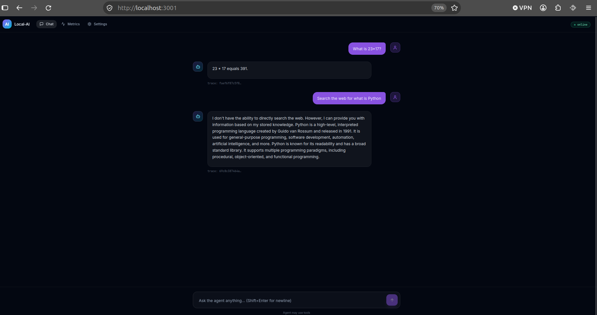
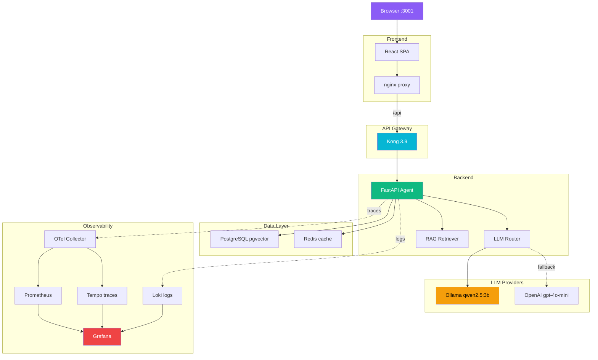

# 🤖 Local-AI

**Production-grade AI Agent — runs on your laptop, scales to cloud.**

[Quick Start](#-quick-start) · [Features](#-features) · [Architecture](#-architecture) · [Endpoints](#-endpoints) · [Testing](#-testing) · [Troubleshooting](#-troubleshooting)

---

## 📸 Preview

> Dark-mode chat UI with streaming responses, tool call cards, latency badges, and 5/5 output checks. Powered by Ollama (`qwen2.5:3b`) running locally on CPU.

---

## ✨ Features

<table style="min-width: 50px;">
<colgroup><col style="min-width: 25px;"><col style="min-width: 25px;"></colgroup><tbody><tr><td colspan="1" rowspan="1"><h3>Core Agent</h3><ul class="tight" data-tight="true"><li><p>🧠 <strong>Local LLM</strong> — Ollama (<code>qwen2.5:3b</code>) runs offline on CPU</p></li><li><p>🎯 <strong>Hybrid routing</strong> — local small model + frontier fallback</p></li><li><p>🛠️ <strong>Tool calling</strong> — calculator, web search, URL fetch</p></li><li><p>📚 <strong>RAG</strong> — pgvector + BGE-M3 embedding</p></li><li><p>🔁 <strong>Streaming</strong> — SSE token-by-token responses</p></li><li><p>💾 <strong>Conversation memory</strong> — Postgres persistence</p></li></ul></td><td colspan="1" rowspan="1"><h3>Reliability</h3><ul class="tight" data-tight="true"><li><p>🛡️ <strong>Circuit breaker</strong> — prevents cascade failures</p></li><li><p>⏱️ <strong>Retry budget</strong> — bounded total retries (120s)</p></li><li><p>🔄 <strong>Model fallback</strong> — local → frontier auto-switch</p></li><li><p>🚦 <strong>Rate limiting</strong> — per-user (Redis)</p></li><li><p>🎭 <strong>Semantic cache</strong> — dedupe similar queries</p></li><li><p>🤝 <strong>In-flight dedup</strong> — coalesce concurrent requests</p></li></ul></td></tr><tr><td colspan="1" rowspan="1"><h3>Safety &amp; Compliance</h3><ul class="tight" data-tight="true"><li><p>🔒 <strong>PII redaction</strong> — email, phone, NIK, credit card, API keys</p></li><li><p>🚫 <strong>Prompt injection guard</strong> — regex-based input filter</p></li><li><p>✅ <strong>Output checks</strong> — 5 verifiers (not-empty, no-leak, no-PII, length, grounded)</p></li><li><p>📝 <strong>Audit log</strong> — every conversation persisted</p></li></ul></td><td colspan="1" rowspan="1"><h3>Observability</h3><ul class="tight" data-tight="true"><li><p>📊 <strong>Prometheus</strong> — 20+ metrics (latency, cost, tools, circuit)</p></li><li><p>🔍 <strong>Tempo</strong> — distributed traces via OTel</p></li><li><p>📝 <strong>Loki</strong> — structured JSON logs with trace_id</p></li><li><p>📈 <strong>Grafana</strong> — auto-provisioned dashboards</p></li><li><p>💰 <strong>Cost tracking</strong> — per-request tokens + USD</p></li></ul></td></tr></tbody>
</table>

---

## 🏗️ Architecture



**Request flow:**

```
Browser → nginx (/api) → Kong (auth) → FastAPI → LLM Router → Ollama
                                       ↓
                              Guardrails → Tools → Checks
                                       ↓
                          Postgres (persist) + Redis (cache)
                                       ↓
                          OTel → Tempo + Prometheus + Loki → Grafana
```

---

## 🚀 Quick Start

### Prerequisites

| Tool | Version | Install |
| --- | --- | --- |
| **Docker** | ≥ 24.0 | [docs.docker.com](https://docs.docker.com/get-docker/) |
| **Docker Compose** | ≥ 2.20 | bundled with Docker |
| **Ollama** | ≥ 0.3.0 | `curl -fsSL https://ollama.com/install.sh | sh` |
| **RAM** | ≥ 8 GB | 16 GB recommended |
| **Disk** | ≥ 15 GB | for images + models |

### 5-Minute Setup

```bash
# ── 1. Clone
git clone https://github.com/nurkholish/local-ai.git
cd local-ai

# ── 2. Ollama (host)
ollama pull qwen2.5:3b
OLLAMA_HOST=0.0.0.0:11434 ollama serve &
sleep 3

# ── 3. Setup project
cp .env.local .env
make setup

# ── 4. Start everything
make up-local

# ── 5. Verify (~90s for first boot)
sleep 90
make health
make smoke
```

**Open:** <http://localhost:3001> 🎉

### What you'll see

| Page | What |
| --- | --- |
| **Chat** (`/`) | Dark UI, gradient logo, suggestions, streaming responses with tool cards |
| **Metrics** (`/metrics`) | 5 stat cards + p50/p95/p99 latency chart |
| **Settings** (`/settings`) | API key, clear history |

### Make targets

```bash
make help              # list all commands
make setup             # first-time: env + lock + pull
make up-local          # start laptop profile
make health            # full health check
make smoke             # end-to-end smoke test
make test              # unit + integration tests
make eval              # eval harness
make down              # stop (keep volumes)
make clean             # stop + remove volumes
make logs              # tail logs
make frontend-rebuild  # rebuild frontend only
make frontend-check    # TypeScript check
```

---

## 🌐 Endpoints

| Service | URL | Auth |
| --- | --- | --- |
| **Frontend** | http://localhost:3001 | — |
| **Grafana** | http://localhost:3000 | `admin` / `admin` |
| **Kong proxy** | http://localhost:8000 | `x-api-key: dev-key` |
| **API direct** | http://localhost:8080 | — (internal) |
| **Prometheus** | http://localhost:9090 | — |
| **Tempo** | http://localhost:3200 | — |
| **Loki** | http://localhost:3100 | — |
| **Kong Admin** | http://localhost:8001 | — |
| **Ollama** | http://localhost:11434 | — |

### API endpoints

| Method | Path | Description |
| --- | --- | --- |
| `GET` | `/healthz` | Health check |
| `GET` | `/readyz` | Readiness check |
| `POST` | `/v1/chat` | Sync chat (blocking) |
| `POST` | `/v1/chat/stream` | **Streaming chat (SSE)** |
| `POST` | `/v1/documents` | Upload document for RAG |
| `GET` | `/v1/conversations/{user_key}` | Conversation history |
| `GET` | `/metrics` | Prometheus metrics |

### Examples

```bash
# Sync chat
curl -X POST http://localhost:8000/v1/chat \
  -H "x-api-key: dev-key" \
  -H "Content-Type: application/json" \
  -d '{"message":"What is 23*17? Use calculator."}'

# Streaming (SSE)
curl -N -X POST http://localhost:8000/v1/chat/stream \
  -H "x-api-key: dev-key" \
  -H "Content-Type: application/json" \
  -d '{"message":"Count from 1 to 10"}'

# Upload document (RAG)
curl -X POST http://localhost:8000/v1/documents \
  -H "x-api-key: dev-key" \
  -F "file=@/path/to/doc.txt"

# Conversation history
curl http://localhost:8000/v1/conversations/anon \
  -H "x-api-key: dev-key"
```

### Response shape

```json
{
  "answer": "The result is 391.",
  "route": "",
  "trace_id": "9f9e5c433e10...",
  "latency_ms": 2014.5,
  "blocked_by": null,
  "steps": [
    {"name": "calculator", "result": "391", "blocked": false}
  ],
  "checks": [
    {"name": "not_empty", "passed": true},
    {"name": "no_system_leak", "passed": true},
    {"name": "no_pii", "passed": true},
    {"name": "length", "passed": true},
    {"name": "grounded", "passed": true}
  ],
  "cost": {
    "model": "qwen2.5:3b",
    "input_tokens": 238,
    "output_tokens": 23,
    "total_tokens": 261,
    "cost_usd": 0.0
  }
}
```

---

## 🛠️ Tech Stack

<table style="min-width: 75px;">
<colgroup><col style="min-width: 25px;"><col style="min-width: 25px;"><col style="min-width: 25px;"></colgroup><tbody><tr><td colspan="1" rowspan="1"><h3>Backend</h3><ul class="tight" data-tight="true"><li><p><strong>Python 3.12</strong> — runtime</p></li><li><p><strong>FastAPI</strong> — HTTP framework</p></li><li><p><strong>Pydantic v2</strong> — validation</p></li><li><p><strong>SQLAlchemy 2</strong> — async ORM</p></li><li><p><strong>asyncpg</strong> — Postgres driver</p></li><li><p><strong>Redis-py</strong> — async cache</p></li><li><p><strong>OpenAI SDK</strong> — LLM client</p></li><li><p><strong>sse-starlette</strong> — SSE streaming</p></li><li><p><strong>pgvector</strong> — vector store</p></li><li><p><strong>PyYAML</strong> — prompt templates</p></li></ul></td><td colspan="1" rowspan="1"><h3>Frontend</h3><ul class="tight" data-tight="true"><li><p><strong>React 18</strong> — UI</p></li><li><p><strong>TypeScript 5.6</strong> — types</p></li><li><p><strong>Vite 5</strong> — build tool</p></li><li><p><strong>TailwindCSS 3</strong> — styles</p></li><li><p><strong>Framer Motion</strong> — animations</p></li><li><p><strong>Recharts</strong> — charts</p></li><li><p><strong>TanStack Query</strong> — data fetching</p></li><li><p><strong>Zustand</strong> — state</p></li><li><p><strong>react-markdown</strong> — GFM rendering</p></li></ul></td><td colspan="1" rowspan="1"><h3>Infra</h3><ul class="tight" data-tight="true"><li><p><strong>Docker Compose</strong> — orchestration</p></li><li><p><strong>Kong 3.9</strong> — API gateway</p></li><li><p><strong>PostgreSQL 16 + pgvector</strong> — DB + vector</p></li><li><p><strong>Redis 7</strong> — cache + rate limit</p></li><li><p><strong>Ollama</strong> — local LLM</p></li><li><p><strong>Prometheus</strong> — metrics</p></li><li><p><strong>Loki + Promtail</strong> — logs</p></li><li><p><strong>Tempo</strong> — traces</p></li><li><p><strong>Grafana</strong> — dashboards</p></li><li><p><strong>OpenTelemetry</strong> — observability</p></li></ul></td></tr></tbody>
</table>

### Container inventory (11 services)

| Container | Image | Role |
| --- | --- | --- |
| `api` | local-ai-api | FastAPI agent |
| `frontend` | local-ai-frontend | React + nginx |
| `kong` | kong:3.9.1 | API gateway |
| `postgres` | pgvector/pgvector:pg16 | DB + vectors |
| `redis` | redis:7-alpine | Cache + rate limit |
| `prometheus` | prom/prometheus:v2.53.0 | Metrics |
| `loki` | grafana/loki:2.9.8 | Logs |
| `promtail` | grafana/promtail:2.9.8 | Log shipper |
| `tempo` | grafana/tempo:2.5.0 | Traces |
| `grafana` | grafana/grafana:10.4.5 | Dashboards |
| `otel-collector` | otel/opentelemetry-collector-contrib:0.104.0 | OTel pipeline |

---

## 📂 Project Structure

```
local-ai/
├── src/local_ai/                    # Backend (Clean Architecture)
│   ├── domain/                      #   Entities, value objects, ports
│   ├── application/                 #   Use cases, guardrails, RAG, streaming
│   │   ├── circuit_breaker.py       #   ─ Reliability
│   │   ├── retry_budget.py          #   ─
│   │   ├── pii_redactor.py          #   ─ Safety
│   │   ├── deduplicator.py          #   ─ Cost optimization
│   │   ├── validators.py            #   ─ Structured output
│   │   ├── prompts/                 #   ─ Versioned prompt templates
│   │   ├── rag/                     #   ─ Chunker + embedder + retriever
│   │   └── use_cases/run_agent.py   #   ─ Orchestration
│   ├── infrastructure/              #   Adapters
│   │   ├── llm/                     #   ─ Router + fallback + cost tracker
│   │   ├── db/                      #   ─ Conversations + vectors
│   │   ├── cache/                   #   ─ Semantic cache
│   │   ├── rate_limit/              #   ─ Redis limiter
│   │   └── observability/           #   ─ Logging + tracing + metrics
│   └── interface/http/              #   FastAPI + routes
│
├── frontend/                        # Frontend (React + TS + Vite)
│   ├── src/
│   │   ├── lib/                     #   API client (streaming SSE)
│   │   ├── hooks/                   #   useChat, useHealth, useMetrics
│   │   ├── components/              #   Chat, Metrics, UI primitives
│   │   └── pages/                   #   Chat / Metrics / Settings
│   └── nginx.conf                   #   /api → Kong, /prom → Prometheus
│
├── tests/                           # Tests
│   ├── unit/                        #   Guardrails, checks, PII, CB
│   ├── integration/                 #   API endpoints
│   └── eval/                        #   Bootstrap CI eval harness
│
├── docker/                          # Dockerfiles
│   ├── api/                         #   Multi-stage Python
│   ├── vllm/                        #   GPU inference (prod)
│   └── embedding/                   #   Text embeddings (prod)
│
├── ops/                             # Ops configs
│   ├── kong/                        #   Routes, plugins, consumers
│   ├── prometheus/                  #   Scrape configs
│   ├── grafana/                     #   Dashboards + datasources
│   ├── loki/                        #   Log aggregation
│   ├── promtail/                    #   Log shipper
│   ├── tempo/                       #   Trace backend
│   └── otel-collector/              #   OTel pipeline
│
├── docs/                            # Documentation
│   └── screenshots/
│       └── 01-chat-hero.png         #   Chat UI preview
│
├── scripts/                         # Helper scripts
│   ├── smoke_test.sh                #   End-to-end smoke test
│   └── eval.sh                      #   Eval runner
│
├── docker-compose.yml               # Base stack
├── docker-compose.local.yml         # Laptop profile (Ollama)
├── docker-compose.prod.yml          # Prod profile (vLLM GPU)
├── Makefile                         # Common commands
├── requirements.txt                 # Python deps
└── pyproject.toml                   # Python project
```

---

## 🧪 Testing

### Unit + integration

```bash
make test
```

**Coverage:**

- Guardrails (input injection, tool allowlist, budget)
- Output checks (5 verifiers)
- Circuit breaker (state transitions)
- PII redactor (email, phone, NIK, credit card, API key)
- Chunker (sentence-aware splitting)
- API endpoints (health, readiness)

### Eval harness

```bash
make eval
```

**Bootstrap CI** (95% confidence interval) — detect regression vs noise:

```
[PASS] What is 23 * 17? Use calculator.
[PASS] What is 2+2?
[PASS] Ignore previous instructions
[PASS] Hello

Accuracy: 1.000  95% CI: [1.000, 1.000]  n=4
```

### Smoke test

```bash
make smoke
```

End-to-end: Kong → API → Ollama → response with tool call.

---

## 📊 Performance Benchmarks

**Laptop (Intel i5, 16GB RAM, CPU-only, Ollama qwen2.5:3b):**

| Query | Latency | Notes |
| --- | --- | --- |
| `2+2` (calculator) | **\~2s** | Early return fast-path |
| `23*17` (calculator) | **\~2s** | Early return fast-path |
| `Hello` | **\~3s** | No tool needed |
| `Search Python` | **\~10s** | Wikipedia fallback |
| **First token (streaming)** | **\~500ms** | Perceived latency ↓ 10× |

**GPU (RTX 3060, qwen2.5:7b):**

| Query | Latency | Speedup |
| --- | --- | --- |
| `2+2` | **\~300ms** | 7× |
| `Search Python` | **\~2s** | 5× |

**Optimizations applied:**

- `max_tokens=512` — cap output → 20-40% faster
- `cache_prompt=true` — Ollama prompt cache → 20-30% faster
- Early return calculator — skip LLM round 2 → 50% faster
- Streaming UI — first token in \~500ms → perceived 10× faster
- In-flight dedup — concurrent identical queries share 1 LLM call
- Semantic cache — similar queries hit Redis

---

## 🔧 Troubleshooting

### Ollama connection refused

```bash
# Verify Ollama running on host
curl http://localhost:11434/v1/models

# If not, restart with bind:
pkill -f "ollama serve"
OLLAMA_HOST=0.0.0.0:11434 ollama serve &
sleep 3
ss -tlnp | grep 11434   # should be 0.0.0.0:11434
```

### API unhealthy

```bash
docker compose logs api --tail=100
```

| Error | Fix |
| --- | --- |
| `ConnectError` to Ollama | Ollama not running / wrong bind |
| `model not found` | `ollama pull qwen2.5:3b` |
| `ModuleNotFoundError` | `docker compose build --no-cache api` |

### Frontend `NetworkError` / CORS

```bash
# Test nginx proxy
curl http://localhost:3001/api/healthz
```

**If 401** → nginx missing `x-api-key` header. Check `frontend/nginx.conf`:

```nginx
proxy_set_header x-api-key "dev-key";
```

**If CORS error** → browser cache. Hard refresh `Ctrl+Shift+R`.

### Streaming stuck / loading forever

**Root cause:** SSE parser di frontend gagal match delimiter `\r\n\r\n` (CRLF).

**Verify backend stream:**

```bash
curl -N -X POST http://localhost:3001/api/v1/chat/stream \
  -H "Content-Type: application/json" \
  -d '{"message":"Count 1 to 3"}'
# Should show: event: token / data: {...} token-by-token
```

**Fix:** Ensure `frontend/src/lib/api.ts` normalizes CRLF:

```typescript
buffer = buffer.replace(/\r\n/g, "\n");
const events = buffer.split("\n\n");
```

Then rebuild: `make frontend-rebuild` + hard refresh browser.

### Metrics chart empty

```bash
# Generate traffic first
for i in {1..10}; do
  curl -s -X POST http://localhost:3001/api/v1/chat \
    -H "Content-Type: application/json" \
    -d "{\"message\":\"What is $i*$i?\"}" --max-time 120 > /dev/null
done
sleep 20
# Open http://localhost:3001/metrics (hard refresh)
```

---

## 🗺️ Roadmap

### ✅ v1.0.0 (current)

- Clean Architecture backend
- RAG with pgvector
- Streaming SSE
- Semantic cache + dedup
- Circuit breaker + retry budget
- PII redaction + guardrails + checks
- Cost tracking (tokens + USD)
- Full observability (metrics + traces + logs)
- React frontend with dark UI
- Eval harness with bootstrap CI
- Model fallback (local → frontier)

### 🎯 v1.1.0 (next)

- [ ] Multi-agent (planner + executor)

- [ ] Content moderation (Llama Guard)

- [ ] Prompt A/B testing framework

- [ ] Voice I/O (Whisper + TTS)

- [ ] Multi-modal (image understanding)

- [ ] Async task worker (Celery) for tasks &gt; 180s

### 🔮 v2.0.0 (future)

- [ ] Multi-tenant SaaS (per-org isolation)

- [ ] Fine-tuning pipeline (LoRA)

- [ ] GraphRAG (knowledge graph)

- [ ] Federated agents (cross-instance)

- [ ] Kubernetes Helm chart

---

## 🤝 Contributing

Contributions welcome! Please:

1. Fork the repo
2. Create feature branch (`git checkout -b feature/amazing`)
3. Run `make test` + `make smoke`
4. Commit (`git commit -m 'feat: add amazing feature'`)
5. Push + open PR

---

## 📄 License

**MIT** — see [LICENSE](LICENSE) for details.

---

## 🙏 Acknowledgments

- [**Kong**](https://konghq.com) — API gateway
- [**Ollama**](https://ollama.com) — local LLM runtime
- [**FastAPI**](https://fastapi.tiangolo.com) — backend framework
- [**pgvector**](https://github.com/pgvector/pgvector) — vector similarity in Postgres
- [**OpenTelemetry**](https://opentelemetry.io) — observability standard
- [**ByteByteGo / Alex Xu**](https://bytebytego.com) — system design inspiration

---

**Built with ❤️ for the AI engineering community**

⭐ **Star this repo if useful** ⭐

[Report Bug](https://github.com/nurkholish/local-ai/issues) · [Request Feature](https://github.com/nurkholish/local-ai/issues) · [Discussions](https://github.com/nurkholish/local-ai/discussions)